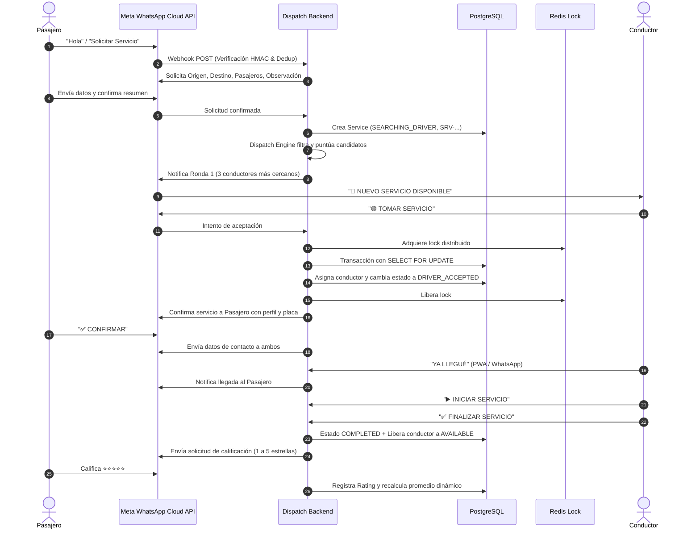

# Arquitectura del Sistema de Despacho Inteligente

## 1. Principios de Diseño
* **Agnosticismo de Canales**: La lógica de despacho, cálculo de scoring, asignación atómica y reputación reside íntegramente en el backend (`src/modules/*`), sin acoplarse a WhatsApp. Si en el futuro se añade una App móvil nativa en Flutter/React Native, reutiliza los mismos servicios y endpoints.
* **Trazabilidad Inmutable**: Cada cambio de estado de un viaje se almacena de forma inmutable en la tabla `ServiceEvent`, permitiendo auditar con exactitud el segundo en que se notificó, se aceptó o se completó un servicio.
* **Resiliencia ante Fallos Externos**: Si Meta WhatsApp o Google Maps sufren degradación o caída de red, el sistema captura los errores con políticas de reintento y fallback sin interrumpir la operación del panel web ni congelar la base de datos.

## 2. Diagrama de Flujo Punta a Punta

## 3. Matriz de Estados del Servicio (`ServiceStatus`)

| Estado Inicial | Siguientes Estados Permitidos | Disparador |
| :--- | :--- | :--- |
| `CREATED` | `SEARCHING_DRIVER`, `CANCELLED_BY_CUSTOMER`, `EXPIRED` | Sistema / Pasajero |
| `SEARCHING_DRIVER` | `DRIVER_OFFERED`, `NO_DRIVER_AVAILABLE`, `CANCELLED_BY_CUSTOMER` | Dispatch Engine |
| `DRIVER_OFFERED` | `DRIVER_ACCEPTED`, `SEARCHING_DRIVER`, `WAITING_CUSTOMER_CONFIRMATION` | Conductor |
| `DRIVER_ACCEPTED` | `CONFIRMED`, `DRIVER_EN_ROUTE`, `CANCELLED_BY_DRIVER` | Pasajero / Conductor |
| `WAITING_CUSTOMER_CONFIRMATION`| `CONFIRMED`, `SEARCHING_DRIVER`, `CANCELLED_BY_CUSTOMER` | Pasajero |
| `CONFIRMED` | `DRIVER_EN_ROUTE`, `DRIVER_ARRIVED`, `CANCELLED_BY_DRIVER` | Conductor |
| `DRIVER_EN_ROUTE` | `DRIVER_ARRIVED`, `CANCELLED_BY_DRIVER` | Conductor |
| `DRIVER_ARRIVED` | `PASSENGER_PICKED_UP`, `IN_PROGRESS`, `CANCELLED_BY_DRIVER` | Conductor |
| `IN_PROGRESS` | `COMPLETED` | Conductor |
| `COMPLETED` | *Terminal* | Pasajero (Califica) |
| `CANCELLED_BY_DRIVER` | `SEARCHING_DRIVER` (Reactivación automática) | Sistema |
